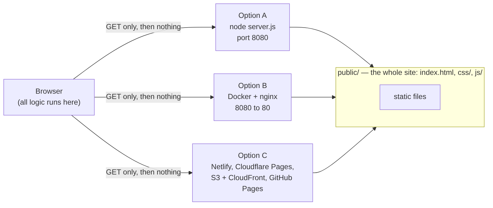

# ISKCON Resolve — interactive prototype

A working, clickable prototype of the ISKCON Resolve confidential booking service and its behind-the-scenes console, built from the *ISKCON Resolve build specification (with VV edits)*. All people and data are **fictional samples**.

It is a **front-end only** prototype: plain HTML, CSS and JavaScript, no framework, no build step, no database and no backend. State lives in the browser tab and resets on reload (or with the **Reset demo** button).



## Version 2: the anonymous model (current)

* **No personal data from the person asking for help.** Booking asks for a language, a region of the world and a few matching answers. No name, email or phone number, and no field for the matter.
* **Numbers only.** Every contact is stored as `contact-M` (auto-increment) and gets its own `anonymous-user-N`. The system cannot tell a returning visitor from a new one, so it never merges them. Only the ombuds can say "this is someone I spoke with before" when closing a case, which links the two anonymous users and works out the number of conversations.
* **No email anywhere.** After booking, the visitor gets a private ticket link (`#ticket/<token>`, stored only as a hash) with a calendar file titled "Conversation", the video link, cancel, reschedule, delete-ticket and the survey. "I can't find a time" and the concerns form are anonymous counters with fixed categories; free text is checked for contact details.
* **Visitor survey.** The 10-question Ombuds Services Survey (from the Google Form) is rebuilt natively and reached from the ticket. Answers carry no key to a contact. Results show in the annual report, suppressed below 5.
* **Closing form for the ombuds** (4 steps, from the data-collection categories and the NASA tracker): the case (dates, location, visitors, visitor category, risk), what it was about (61 issues in 9 groups), what you did (7 services, 13 optional impacts), the conversations. Private notes must be confirmed destroyed.
* **Retention.** 30 days after the last conversation the exact time, ticket hash and case number are deleted; the numbered rows remain.
* **Scale.** Open with `?scale=20000` to seed that many cases. Tables are paged, and report calculations are cached. A 20,000-case test is in the suite.
* **Phone.** Booking, ticket, survey and closing form fit 390px with 44px tap targets.

Sections below that mention email, a confirmation email or a name on the booking describe version 1 and the ombuds onboarding (staff, not visitors).

## Ombuds onboarding

* **Admin panel:** *Behind the scenes → Onboarding (admin)*. Invite an ombuds, review what people submit (only the changed fields are listed), approve or send back with a reason, pause or resume someone, see who the panel covers (languages, regions, skills, background), and test the visitor matching for any combination of answers.
* **Self-service screen:** `#me` (the “Ombuds on a phone” tab). Built for a 390px screen: three tabs (Availability, My details, Preview), 44px tap targets, no horizontal scrolling. In the live service it opens from a private link in the invitation email.
* **What an ombuds provides:** diksha name, legal name (admin only, never public), man or woman, region, city, temple, time zone, languages with a level, skills, professional background, years of experience, current role or seva, regions and subjects they will not take, a short introduction, and when they are free.
* **Availability:** they open *windows* (for example 18:00 to 21:00). Each window is cut into 60-minute slots with a 20-minute gap. They set a usual week, then change particular dates, close single times, take a day off, mark a whole week away, or copy a week forward. Visitors can book no sooner than 48 hours ahead and no later than 5 weeks ahead. Booked times are locked.
* **Approval:** availability and the monthly limit apply at once. Anything a visitor reads, or that affects matching, goes to the Project Manager first.
* **Matching:** the visitor's three answers (language, nearest region, man or woman) filter the list using the languages, region and gender recorded here. Skills, background, experience and role are displayed, not used to filter, because filtering on them would mean asking what the matter is about before the call.

## Quick start (local)

Requires Node 18 or newer. Nothing to install to *run* it.

```bash
cd iskcon-resolve-prototype
npm start                # http://localhost:8080
PORT=3000 npm start      # another port
HOST=127.0.0.1 npm start # only this machine (default is all interfaces)
```

Other ways to serve the same `public/` folder:

```bash
python3 -m http.server 8080 --directory public     # no Node needed (no security headers)
npx serve public                                    # any static server works
```

## Deploy

### A. A cloud VM (Node + HTTPS reverse proxy)

```bash
# on the server, with Node 18+
git clone <your repo> /opt/resolve-prototype    # or copy the folder up
cd /opt/resolve-prototype
```

`/etc/systemd/system/resolve-prototype.service`:

```ini
[Unit]
Description=ISKCON Resolve prototype
After=network.target

[Service]
WorkingDirectory=/opt/resolve-prototype
Environment=PORT=8080 HOST=127.0.0.1
ExecStart=/usr/bin/node server.js
Restart=always
User=www-data

[Install]
WantedBy=multi-user.target
```

```bash
sudo systemctl enable --now resolve-prototype
```

Put HTTPS in front. With Caddy (automatic certificates), `Caddyfile`:

```
resolve-demo.example.com {
  reverse_proxy 127.0.0.1:8080
}
```

### B. Docker (any host that runs containers)

```bash
docker compose up -d --build        # http://localhost:8080
# or
docker build -t resolve-prototype . && docker run -d -p 8080:80 resolve-prototype
```

The image is `nginx:alpine` serving `public/`, with the security headers in `nginx.conf`.

### C. Static hosting (no server to run)

Upload the **`public/`** folder to Netlify, Cloudflare Pages, Vercel, GitHub Pages, or S3 + CloudFront. `public/_headers` carries the security headers for Netlify and Cloudflare Pages. On other hosts, set the same headers in their configuration, or skip them: the app works without them.

## What the security headers do

The Content-Security-Policy includes `connect-src 'none'`, so the browser itself refuses any `fetch`, XHR, WebSocket or beacon from the page. That enforces, rather than merely claims, the spec’s promise that nothing leaves the visitor’s browser. `style-src` allows inline styles because the prototype sets a few style attributes; scripts are same-origin only.

## Tests

```bash
npm install
npx playwright install chromium      # one-off, downloads a browser
npm test
```

The suite (`tests/e2e.js`) starts the real server and drives headless Chromium through 59 checks, including: the onboarding flow end to end (invite, submit, approve, go live, visitor finds them); that legal names never reach the visitor site; the slot rules for whatever hours someone sets; and the self-service screens at 390px; matching with zero network requests; the 48-hour minimum and 80-minute slot cycle; booking, with contact details stored separately from the case; closing with fixed choices only; the mentor prompt at the third conversation; the 30-day purge leaving the case row; the below-five suppression rule; survey stores with no linking key; permissions (no one, including the Director, can read a conversation); the consent-copy release gate; the in-app acceptance tests; phone-width layout; and zero console, CSP or network errors across the whole session.

## Project layout

```
public/                 the entire site — this is all that gets deployed
  index.html
  css/styles.css        design tokens (light and dark), layout
  js/data.js            regions, issue taxonomy, sample panel, seeded history   (spec 3.2, 3.3)
  js/i18n.js            interface strings in 5 languages (headline strings only)
  js/core.js            state, routing, network monitor, privacy inspector
  js/visitor.js         home, booking flow, surveys, self-guided pathway, other pages (spec parts 2, 5)
  js/staff.js           ombuds workspace, data stores, reports, inboxes, access, tests, build notes (parts 1, 3, 4, 6)
  js/ombuds.js          onboarding: admin panel and the phone self-service screen
  js/boot.js
server.js               zero-dependency static server with security headers
tests/e2e.js            end-to-end tests
Dockerfile  docker-compose.yml  nginx.conf
```

Scripts are classic `<script>` tags that share one global scope, in the order listed in `index.html`. There is no bundler by design.

## Changing things

* **The panel, regions, issue categories:** `public/js/data.js`. The taxonomy there is copied from the spec and should only change with a migration plan.
* **Wording:** English copy is in `visitor.js` (spec Part 5) and `i18n.js`. Only the headline strings are translated, and those translations are not reviewed by a language owner.
* **Colours and type:** the tokens at the top of `public/css/styles.css`. Fonts are system fonts so the page makes no font requests; the real build self-hosts Noto.

## What is simulated, and what is not tested

Simulated: calendar file, video link, staff invitation email, the nightly purge job (runs when the demo clock moves), the protected spreadsheet, and the Google Workspace settings. There is **no persistence**, so closing the tab loses everything. Onboarding specifics: the invitation email and the private link are simulated (the page has no login); availability uses fixed UTC offsets, so a daylight-saving change is **not handled** (the real build must store named time zones such as Asia/Kolkata and America/New_York); times are chosen in 30-minute steps; two people editing the same availability at once is not modelled.

Not for real use: do not point real visitors at this. It has no server-side controls, because it has no server-side. The production architecture in the spec (static builds per language, Workspace configuration, scheduled purge, protected sheet) is a separate build.

Tested here: the Node server and the full e2e suite on headless Chromium (Linux). **Not tested:** the Docker image and `nginx.conf` (no Docker daemon or nginx was available where this was built), Firefox and Safari, and screen readers. The `nginx.conf` repeats the headers inside `location /` on purpose, because nginx drops server-level `add_header` lines when a location sets its own.

## Where the specification disagrees with itself

Listed in the app under *Behind the scenes → Build and open questions*: 13 regions listed against “fourteen” in the text; handling values (8 listed, enum(7)); two wordings of the confidentiality promise (4.1 vs 5.1); “three” vs four end-of-call survey questions; the “who I speak with” filter needing the visitor’s gender, which is never asked; the region source for the “See everyone” door; a fourth input to the risk rule; wellbeing flags (“mentor only” vs on the dashboard); the unnamed Operations administrator; and values held only in the companion documents. The onboarding screens add four more decisions, listed in the same place: whether skills may ever filter, who holds legal names and for how long, whether profile changes need approval, and how the private link authenticates.
